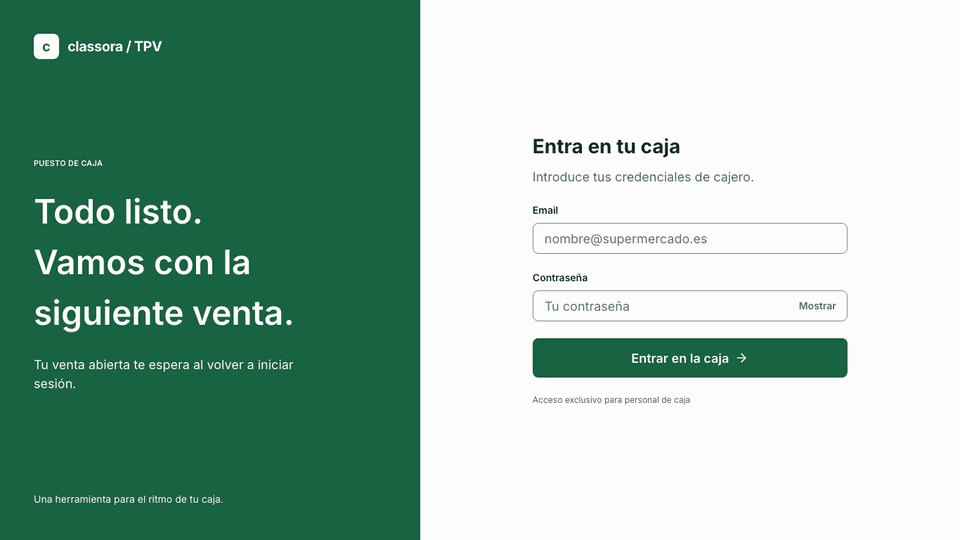

# 🛒 Classora TPV — Frontend (React 19)

[](https://github.com/DiegoVilla27/prueba-tecnica-classora-fe/actions/workflows/ci.yml)
[](https://react.dev/)
[](https://www.typescriptlang.org/)
[](https://vite.dev/)
[](https://tailwindcss.com/)
[](https://playwright.dev/)
[](https://classora-tpv-prod.vercel.app)

Caja de supermercado para la prueba técnica de **Classora Technologies**: el cajero inicia sesión, escanea productos por código y gestiona la venta contra una **API Java real** ([`prueba-tecnica-classora-be`](https://github.com/DiegoVilla27/prueba-tecnica-classora-be)). Prioridades: **rapidez de uso, legibilidad, accesibilidad y prevención de errores**.



---

## 🌐 Pruébalo

| Entorno | App | API (Swagger) | Cajero demo |
| :-- | :-- | :-- | :-- |
| **prod** | https://classora-tpv-prod.vercel.app | [pos-api-prod](https://pos-api-prod.onrender.com/api/v1/api-docs/swagger-ui.html) | `cajero@pos.prod` / `cajero1234` |
| **dev** | https://classora-tpv-dev.vercel.app | [pos-api-dev](https://pos-api-dev-k0y9.onrender.com/api/v1/api-docs/swagger-ui.html) | `cajero@pos.dev` / `cajero1234` |
| local | http://localhost:3000 | http://localhost:8080/api/v1 | `cajero@pos.local` / `cajero1234` |

> ⏳ La API usa el plan gratuito de Render: tras 15 min sin uso se duerme y **el primer acceso puede tardar ~50 s**. La app lo avisa ("No se pudo conectar con el servidor. Puede tardar hasta un minuto en arrancar…" en el login, "Conectando con el servidor…" en la caja): basta con reintentar.

**Códigos para escanear** (catálogo de 20 productos EAN-13): `8412345000010` Leche · `8412345000027` Pan · `8412345000034` Huevos · `8412345000041` Aceite · `8412345000119` Bolsa. Con multiplicador: `6*8412345000010`. Uno inexistente: `0000`.

**Historial**: pestaña **Ventas** de la cabecera (`/ventas`), con el detalle de cada venta.

**Atajos**: `Enter` añadir · `F12` finalizar · `↑ ↓` seleccionar línea · `+ -` cantidad · `Supr` eliminar · `Ctrl+Z` deshacer · `Esc` cerrar / deseleccionar.

---

## 📦 Entregables de la prueba

| Parte del enunciado | Dónde está |
| :-- | :-- |
| **1 · Diseño en Figma** | [Classora TPV · Login y caja](https://www.figma.com/design/hbVVhN8sPqR56dLazj9IEy/Classora-TPV-%C2%B7-Login-y-caja) · capturas en [`docs/figma/`](docs/figma/) · **Figma vs app** lado a lado en [`docs/figma/vs-app/`](docs/figma/vs-app/) · tokens y componentes en [`docs/03-ux-ui.md`](docs/03-ux-ui.md) |
| **2 · Implementación React** | Este repo: añadir por código ✅ · mismo código suma cantidad ✅ · modificar y eliminar líneas ✅ · total automático ✅ · error de código inexistente ✅ (y no válido, sin conexión, máximo 999) |
| **3 · Integración con el backend Java** | Sistema real: [§ Integración](#-integración-con-el-backend-java-parte-3) y [`docs/06-integracion-backend.md`](docs/06-integracion-backend.md) |
| **4 · Uso de la IA** | [`AI_LOG.md`](AI_LOG.md): cada petición, qué hizo la IA, qué se corrigió y qué decidió el autor |

---

## ✨ Qué hace

- **Login** con validación (React Hook Form + Zod), errores claros (credenciales, demasiados intentos, servidor dormido) y aviso de sesión caducada. Refresco de token silencioso.
- **Escaneo**: el campo de código siempre tiene el foco; un lector puede disparar códigos sin pausa (cola en orden, verificada con un e2e a velocidad de lector). Multiplicador `N*código`.
- **Venta optimista**: cada acción se ve al instante y se reconcilia con el servidor; si falla, vuelve atrás y avisa. El servidor es la fuente de verdad de precios y totales.
- **Líneas**: − / + (máximo 999), eliminar con **Deshacer** (sin modales que frenen), último añadido resaltado.
- **Finalizar** (F12, `Enter` confirma): se abre **sola una venta nueva** con el panel a 0 y un aviso del importe cobrado. **Vaciar** con confirmación destructiva. La venta abierta **se recupera** al recargar o al volver a iniciar sesión.
- **Historial de ventas** (`/ventas`): tabla paginada con fecha, estado, artículos, productos y total; **Ver** abre el detalle con sus líneas.
- **Pantalla completa**: la tabla y el panel del total llegan hasta el final de la ventana; la lista hace scroll por dentro con la cabecera fija.
- **Accesible**: WCAG 2.2 AA, todo con teclado, anuncios para lectores de pantalla, revisado con `axe` y VoiceOver ([checklist](docs/03-ux-ui.md#7-checklist-de-accesibilidad-wcag-22-aa)).

---

## 🔌 Integración con el backend Java (Parte 3)

La integración no es teórica: el front consume la API Spring Boot en local, Docker, dev y prod, y el CI la prueba en cada PR con la imagen real del back.

**Buscar un producto por código** (el endpoint central de la prueba):

```
ScanForm → useProductLookup (TanStack Query, caché 5 min) → getProductByCodeSvc
        → httpService → axios + interceptor JWT → GET /api/v1/products/{code}
        ← 200 ProductResponseDTO { id, code, name, price: 0.95 }  → Zod → mapper → Product { unitPrice: 95 céntimos }
        ← 404 ErrorResponseDTO { status, message }                 → ProductNotFoundError → error inline
        ← sin respuesta / 5xx                                      → ApiError(null)       → "No se pudo consultar el producto…"
```

En el back, esa petición recorre su arquitectura hexagonal: `ProductController` (valida `^\d{4,14}$`) → `ProductService` → puerto `ProductRepositoryPort` → adaptador JPA → PostgreSQL (índice único en `code`).

**La venta** vive en el servidor (`/sales`): el front envía **solo código y cantidad, nunca precios**, y recibe la venta completa en cada respuesta. Endpoints usados, errores (`400/401/403/404/409/422/429`) y su traducción a la UI: [`docs/06-integracion-backend.md`](docs/06-integracion-backend.md). Contratos completos en el [Swagger](https://pos-api-prod.onrender.com/api/v1/api-docs/swagger-ui.html) y en `docs/04-api.md` del back.

| Pieza | Responsabilidad |
| :-- | :-- |
| `core/axios` · `core/http` | Instancia con la URL de cada entorno; `httpService` tipado |
| `core/interceptors/jwt` | `Bearer` en cada petición; ante 401, **un único** `POST /auth/refresh` para todas las peticiones concurrentes y reintento |
| `core/interceptors/errors` | Todo error se convierte en `ApiError { status, message, fieldErrors }` (`status: null` = sin conexión) |
| `services/dtos` + `mappers` | Zod valida cada respuesta; los euros pasan a **céntimos enteros** en un único sitio |
| `use-sale-mutations` | Mutaciones optimistas en cola (`scope`), líneas identificadas por producto, rollback a la última venta confirmada |

---

## 🏗️ Arquitectura

Modular **por features** (`auth`, `catalog`, `checkout`) con `core` transversal y `shared` reutilizable ([`docs/04-arquitectura.md`](docs/04-arquitectura.md)):

```
src/
├── core/        axios · http · interceptors (jwt, errors) · router + guards · providers · mocks
├── shared/      components/ui (design system) · hooks (use-hotkeys, use-announcer) · utils · test-utils
└── features/
    ├── auth/           login, sesión (useMe, useLogout), cabecera común con pestañas Caja · Ventas
    ├── catalog/        producto por código
    ├── checkout/       models (reglas puras) · store (Zustand) · services · hooks (mutaciones) · screen (la caja)
    └── sales-history/  historial paginado (GET /sales) y detalle de cada venta (GET /sales/{id})
```

- **Design system con Atomic Design** en `shared/components/ui`: 27 piezas (`atoms` → `molecules` → `organisms` → `templates`) sin negocio, con tokens medidos sobre Figma y verificadas con `axe`. Las reglas de qué nivel puede importar a cuál son **errores de lint**.
- **Estado**: TanStack Query para el servidor; Zustand para la venta en pantalla (venta confirmada + cambios optimistas + estado de UI). La lógica de negocio son funciones puras en `models/` (mismas reglas que el agregado del back).
- **React Compiler** activo (sin `useMemo`/`useCallback` a mano), con sus reglas en el linter.

---

## ▶️ Ejecutar

Requisitos: Node 22 y pnpm 11 (`corepack enable`).

```bash
pnpm install
pnpm local:mock        # sin backend: la API la simula MSW en el navegador → http://localhost:3000
pnpm local             # contra el back local en :8080 (ver repo del back)
docker compose up --build -d   # build de producción servido con nginx en :3000 (red shared-network)
```

| Script | Qué hace |
| :-- | :-- |
| `pnpm typecheck` · `pnpm lint` · `pnpm format:check` | Tipos, oxlint (React Compiler, a11y, dependencias), Prettier |
| `pnpm test:unit` · `pnpm test:integration` | Vitest: unitarios con cobertura ≥ 80 % · pantallas completas contra MSW |
| `pnpm e2e` · `pnpm e2e:full-stack` | Playwright contra MSW · contra la API real (`pnpm local` + back en :8080) |
| `pnpm build:prod` | Build de producción |

---

## 🧪 Calidad

| Nivel | Qué | Cifras |
| :-- | :-- | :-- |
| Unit | Modelos, store, servicios, hooks, design system (con `axe`) | 149 tests · cobertura ~88 % líneas / 83 % ramas |
| Integración | Login, caja (I-01…I-12 y alternativos) e historial completos contra MSW | 30 tests |
| E2E mocked | Escaneo rápido, código inexistente, deshacer, todo con teclado, historial + `axe` | 8 specs |
| E2E full-stack | Login, venta completa que aparece en el historial y **recuperar la venta tras recargar**, contra la API real | 4 specs |

Además: auditoría de orden de tabulación, foco visible, árbol accesible y zoom 200 %; pasada manual con VoiceOver.

## 🚀 CI/CD

`feature/*` → PR a `dev` → PR a `main` (ramas protegidas: PR obligatorio + `🛡️ Frontend CI Quality Gate`).

| Job (`.github/workflows/ci.yml`) | |
| :-- | :-- |
| ⚡ Static checks | Rama de origen, Prettier, oxlint, TypeScript |
| 🧪 Unit · 🔗 Integración · 📦 Build | En paralelo |
| 🎭 E2E mocked | Playwright + axe |
| 🧩 E2E full-stack | **Construye la imagen del back desde su repo**, PostgreSQL como servicio, Playwright contra la API real |
| 🛡️ Quality gate | Un único check requerido |

Vercel despliega `dev` → https://classora-tpv-dev.vercel.app y `main` → https://classora-tpv-prod.vercel.app ([`docs/08-despliegue.md`](docs/08-despliegue.md)).

---

## 🧠 Decisiones

| Decisión | Por qué |
| :-- | :-- |
| Venta en el **servidor** con UI **optimista** | Precios y totales fiables (sin manipulación desde el navegador) sin perder la sensación de inmediatez |
| Dinero en **céntimos enteros** | Sin errores de coma flotante en totales |
| **Deshacer** en vez de confirmar al eliminar | Acción frecuente y reversible: un modal frenaría al cajero (sí se confirma vaciar y finalizar) |
| Mutaciones **en cola** e identificadas por producto | Los escaneos rápidos nunca se pierden ni se reordenan |
| `<dialog>` nativo para los modales | Modalidad real (fondo inerte, foco dentro) sin librerías |
| Tokens propios medidos sobre Figma | El archivo de Figma no tenía variables; se ajustaron 2 colores para cumplir AA |

Más decisiones (ADRs) en [`docs/04-arquitectura.md`](docs/04-arquitectura.md#10-decisiones-adrs).

---

## 📚 Documentación

| Doc | Contenido |
| :-- | :-- |
| [`CLAUDE.md`](CLAUDE.md) | Reglas del proyecto: arquitectura, exports, estado, formularios, estilos, accesibilidad, testing, git |
| [`AI_LOG.md`](AI_LOG.md) | Registro del uso de IA (Parte 4) |
| [`docs/01-negocio-y-requisitos.md`](docs/01-negocio-y-requisitos.md) | Contexto, alcance, requisitos, reglas de negocio |
| [`docs/02-casos-de-uso.md`](docs/02-casos-de-uso.md) | Casos de uso y trazabilidad con los tests |
| [`docs/03-ux-ui.md`](docs/03-ux-ui.md) | Principios, frames, tokens, design system, microcopy, accesibilidad |
| [`docs/04-arquitectura.md`](docs/04-arquitectura.md) | Features, sesión, venta optimista, ADRs |
| [`docs/05-testing.md`](docs/05-testing.md) | Estrategia de tests |
| [`docs/06-integracion-backend.md`](docs/06-integracion-backend.md) | Integración con la API Java |
| [`docs/07-roadmap.md`](docs/07-roadmap.md) | Hitos |
| [`docs/08-despliegue.md`](docs/08-despliegue.md) | Entornos, Docker, Vercel, CI |

## 🤖 Uso de IA

Desarrollado con **Claude Code** como asistente, con el autor decidiendo arquitectura, stack y criterio. El [`AI_LOG.md`](AI_LOG.md) registra cada petición, lo que hizo la IA, los fallos que se encontraron (y cómo) y las correcciones humanas; las reglas que sigue el agente están en [`CLAUDE.md`](CLAUDE.md) y [`.claude/skills/`](.claude/skills/).
